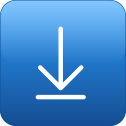
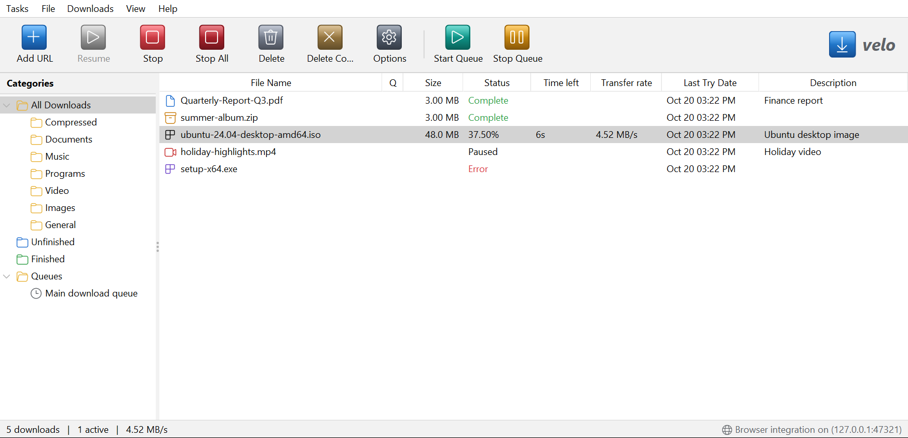
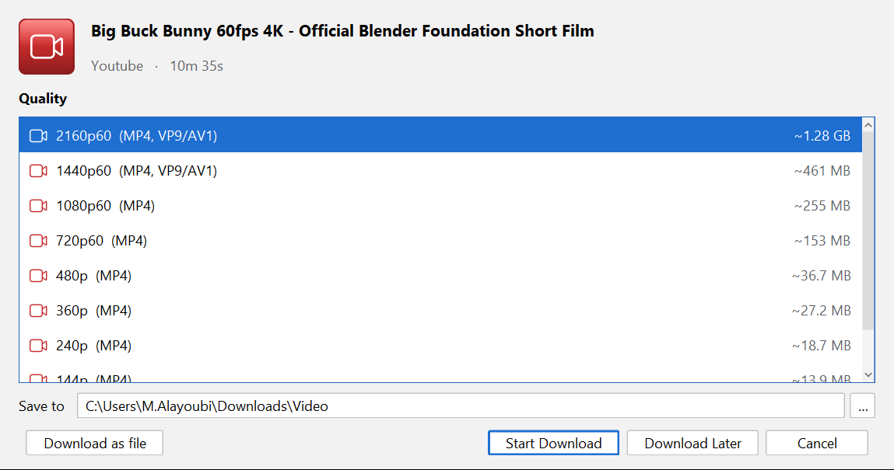

  

<h1 align="center">velo</h1>

  <b>Download files and videos faster, and pick up where you left off.</b> 
  Free download manager for Windows and Linux.

  

  Version 1.0.0 · Windows 10 and 11 (64-bit) · <a href="#-other-downloads">Other downloads (Linux, portable)</a>

  

---

## ✨ What velo does

- 🚀 **Faster downloads.** Each file downloads over up to 32 connections at once.
- ⏸️ **Pause and resume anytime.** Even after closing velo or restarting your PC.
- 🎬 **Video downloads.** Save videos from YouTube, Vimeo and 1000+ other sites in the quality you choose, from 144p to 4K, or as audio only.
- 🌐 **Works with your browser.** A **Download this video** button appears on videos in Chrome and Edge.
- 🗂️ **Stays tidy.** Files are sorted into Video, Music, Documents, Programs and more.
- 🌙 **Light and dark themes.** Sharp on high-resolution screens.

## 💾 Install on Windows in 3 steps

1. **[Download velo-1.0.0.exe](https://github.com/ayoubi1990/utilities/releases/download/velo-v1.0.0/velo-1.0.0.exe)** and open it.
2. If Windows shows **"Windows protected your PC"**, click **More info**, then **Run anyway**. This appears because velo is new and not yet signed, not because something is wrong.
3. Click **Next**, choose whether you want a desktop shortcut, then click **Install**. No admin rights are needed.

Start velo from the **Start menu** or the desktop icon. Everything it needs is included, so there's nothing else to install.

## 🎬 Download a video

1. Open the video page in your browser and copy its address.
2. In velo, press **Ctrl+V** (or click **Add URL** and paste).
3. Pick a quality and click **Start Download**.

  

## 🌐 Add the browser button (optional)

With the browser button, you can download a video straight from the page.

1. In Chrome or Edge, open `chrome://extensions` (or `edge://extensions`).
2. Turn on **Developer mode** (top right).
3. Click **Load unpacked** and choose this folder: `%LOCALAPPDATA%\velo\extension`. Paste that path into the folder box and press Enter.

Now hover over a video and click **Download this video**, or right-click any link and choose **Download with velo**. velo must be running, and it always asks before downloading anything.

## 📦 Other downloads

| I use… | Download | How to install |
|---|---|---|
| Windows (company PC, IT deployment) | [velo-1.0.0.msi](https://github.com/ayoubi1990/utilities/releases/download/velo-v1.0.0/velo-1.0.0.msi) · 149 MB | Double-click it. Silent install: `msiexec /i velo-1.0.0.msi /qn` |
| Windows, without installing | [Portable .zip](https://github.com/ayoubi1990/utilities/releases/download/velo-v1.0.0/velo-1.0.0-windows-x64-portable.zip) · 148 MB | Unzip anywhere, then open `velo\velo.exe` |
| Ubuntu, Debian, Mint | [velo_1.0.0_amd64.deb](https://github.com/ayoubi1990/utilities/releases/download/velo-v1.0.0/velo_1.0.0_amd64.deb) · 186 MB | Double-click it, or run `sudo apt install ./velo_1.0.0_amd64.deb` |
| Fedora, RHEL, openSUSE | [velo-1.0.0-1.x86_64.rpm](https://github.com/ayoubi1990/utilities/releases/download/velo-v1.0.0/velo-1.0.0-1.x86_64.rpm) · 222 MB | `sudo dnf install ./velo-1.0.0-1.x86_64.rpm` |
| Linux, without installing | [Portable .tar.gz](https://github.com/ayoubi1990/utilities/releases/download/velo-v1.0.0/velo-1.0.0-linux-x64-portable.tar.gz) · 223 MB | Extract it, then run `velo/bin/velo` |

To check that a download isn't corrupted, compare its fingerprint with the matching line in [SHA256SUMS.txt](https://github.com/ayoubi1990/utilities/releases/download/velo-v1.0.0/SHA256SUMS.txt). Older versions are on the [releases page](https://github.com/ayoubi1990/utilities/releases).

## ❓ Questions

<b>Is velo free?</b>

Yes. There are no ads, no accounts and no time limits.

<b>Is it safe? Why does Windows warn me?</b>

Windows warns about any new app that isn't signed with a paid certificate yet. velo doesn't collect or send any of your data. The browser button only talks to velo on your own computer. Company PCs may block unsigned apps entirely; in that case, ask your IT department.

<b>Where do my downloads go?</b>

Into your **Downloads** folder, sorted into sub-folders such as `Video`, `Music` and `Programs`. To change the folder, use **Downloads → Options**. To find a file, right-click it in velo and choose **Open folder**.

<b>A video site stopped working. What can I do?</b>

Video sites change often. Use **Help → Update video support**, then try again. Protected streaming services (Netflix, Disney+ and similar) aren't supported.

<b>How do I uninstall velo?</b>

- **Windows:** open **Settings → Apps → velo → Uninstall**.
- **Linux:** run `sudo apt remove velo` (or `sudo dnf remove velo`).

Your download list stays in `%APPDATA%\velo` (Windows) or `~/.local/share/velo` (Linux). Delete that folder too if you want to remove everything.

---

## 🛠️ For developers

- [Building from source and releasing](docs/DEVELOPERS.md)
- [Packaging guide](docs/PACKAGING.md)
- [Third-party notices](source/THIRD-PARTY-NOTICES.txt)

Please only download content you have the right to download.
