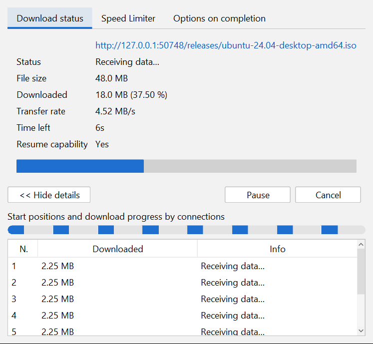

# velo

A fast, resumable, multi-connection download manager for Windows and Linux, with browser integration and video-site support.


## Features

- Up to 32 connections per file, re-split on the fly as connections finish
- Pause and resume, including after closing the app or rebooting
- Categories (Compressed, Documents, Music, Programs, Video, …), a queue, and a global speed limiter
- A per-download progress window with a live connection map
- A Chrome/Edge extension that adds a **Download this video** button and a right-click menu
- YouTube, Vimeo and 1000+ other sites through [yt-dlp](https://github.com/yt-dlp/yt-dlp), with a quality picker
- Light, dark and native themes; sharp on high-DPI screens

## Repository layout

```
source/              application source (Java 21), browser extension, build scripts
installer/windows/   .exe / .msi installers (jpackage + WiX)
installer/linux/     .deb / .rpm packages (jpackage)
installer/portable/  portable .zip (Windows) and .tar.gz (Linux)
docs/                packaging guide and screenshots
```

## Download

Get the files from the **[Releases](../../../releases)** page (releases tagged `velo-v…`). Nothing else needs to be installed: Java, yt-dlp, ffmpeg and deno are all bundled.

| System | File | Install |
|---|---|---|
| Windows 10/11 x64 | `velo-<v>.exe` or `.msi` | Run it. No admin rights needed. It adds a Start menu entry and an optional desktop shortcut. |
| Windows, no install | `velo-<v>-windows-x64-portable.zip` | Unzip anywhere and run `velo\velo.exe`. |
| Debian / Ubuntu | `velo_<v>_amd64.deb` | `sudo apt install ./velo_<v>_amd64.deb` |
| Fedora / RHEL / openSUSE | `velo-<v>-1.x86_64.rpm` | `sudo dnf install ./velo-<v>-1.x86_64.rpm` |
| Linux, no install | `velo-<v>-linux-x64-portable.tar.gz` | `tar xzf` it anywhere and run `velo/bin/velo`. |

`SHA256SUMS.txt` on each release lists every file's checksum.

**Windows notes:**

- Unsigned builds trigger SmartScreen. Click **More info**, then **Run anyway**.
- **Upgrade:** run the newer installer.
- **Uninstall:** **Settings > Apps > velo**.
- **Silent install:** `msiexec /i velo-<v>.msi /qn`

**Linux notes:**

- The packages install to `/opt/velo` and add a menu entry. The command-line tool is `/opt/velo/bin/velo-cli`.
- **Uninstall:** `sudo apt remove velo` or `sudo dnf remove velo`.

## Browser extension

1. Open `chrome://extensions` (or `edge://extensions`).
2. Turn on **Developer mode**.
3. Click **Load unpacked** and select velo's `extension` folder:
   - Windows installer: `%LOCALAPPDATA%\velo\extension`
   - Linux packages: `/opt/velo/lib/extension`
   - Portable builds: the `extension` folder inside the unpacked package.

Keep velo running. Then:

- Hover over a video and click **Download this video**.
- Or right-click a link and choose **Download with velo**.

Every link is confirmed in velo before anything downloads.

## Video sites (YouTube, Vimeo, …)

Click the video button on the page, or use **Tasks > Add video page…**. Then pick a quality and click **Start Download**.


If a site stops working, use **Help > Update video support** to update yt-dlp. **Downloads > Options** shows which tools velo is using.

## Usage

| Action | How |
|---|---|
| Add a download | **Add URL**, or copy a link and press **Ctrl+V** |
| Pause / resume | **Stop** / **Resume** in the toolbar |
| Progress window | double-click an unfinished download |
| Open a finished file | double-click it, or press **Enter** |
| Delete | **Del** (optionally deletes the file too) |
| Speed limit, connections, folders | **Downloads > Options** |
| Theme | **View > Light / Dark / native look** |
| Command line | `velo-cli -o ~/Downloads -c 8 https://example.com/file.iso` |



| Item | Windows | Linux |
|---|---|---|
| Download list and settings | `%APPDATA%\velo\downloads.properties` | `~/.local/share/velo/downloads.properties` |
| Updated yt-dlp | `%APPDATA%\velo\tools` | `~/.local/share/velo/tools` |
| Downloaded files | `%USERPROFILE%\Downloads\<Category>` | `~/Downloads/<Category>` |
| Unfinished downloads | `<file>.part` + `<file>.velo` | same |

## Troubleshooting

| Problem | Fix |
|---|---|
| Browser button says "velo is not running" | Start velo. The status bar must show *Browser integration on (127.0.0.1:47321)*. |
| "Video support is not available" | The `tools` folder is missing or blocked by antivirus or company policy. Reinstall, or allow `tools\*.exe`. |
| A video site fails or finds no formats | **Help > Update video support** |
| velo is blocked on a company PC | Application-control policy blocks unsigned apps; ask IT, or use a signed release. |

## Build from source

Requires JDK 21+.

| | Windows (PowerShell) | Linux (bash) |
|---|---|---|
| Build + test | `source\build.ps1 -Test` | `bash source/build.sh --test` |
| Run | `source\velo-ui.cmd` | `java -jar source/velo.jar` |
| Installer | `installer\windows\package.ps1 -Type exe -Version 1.0.0` (or `-Type msi`) | `bash installer/linux/package.sh --type deb --version 1.0.0` (or `rpm`) |
| Portable | `installer\portable\make-portable.ps1 -Version 1.0.0` | `bash installer/portable/make-portable.sh --version 1.0.0` |

Everything is written to `dist/`.

**Build tools:**

- The scripts download yt-dlp, ffmpeg (LGPL) and deno from their official GitHub releases and check them against the publishers' SHA-256 checksums. Add `-NoVideoTools` / `--no-video-tools` to build without them.
- Windows installers need WiX 3.14. If it isn't installed, `installer\windows\fetch-wix.ps1` downloads a checksum-pinned copy.
- Linux packages need `fakeroot` (for `.deb`) or `rpm` (for `.rpm`).

**Release:** push a `velo-v` version tag and GitHub Actions (`.github/workflows/velo.yml` at the repository root) builds, tests and publishes every package:

```bash
git tag velo-v1.0.0
git push origin velo-v1.0.0
```

Signing and other packaging details: [docs/PACKAGING.md](docs/PACKAGING.md).

## License notes

Third-party components are listed in [source/THIRD-PARTY-NOTICES.txt](source/THIRD-PARTY-NOTICES.txt). DRM-protected services are not supported. Only download content you have the right to download.
